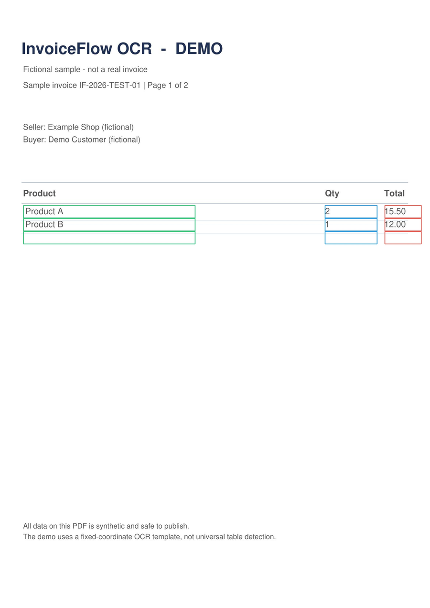

# InvoiceFlow OCR

**Python desktop: faktura PDF → OCR → ręczna korekta → zatwierdzenie → bezpieczna aktualizacja kopii magazynu CSV.**

**v0.6** · Python 3.12+ · OpenCV · Tesseract · Poppler · Pandas · CustomTkinter · SQLite (stdlib) · pytest



*Fikcyjny przykład PDF z naniesionymi obszarami OCR. To nie zrzut ekranu z GUI.*

## Nowości v0.6 — wygoda i przygotowanie wydania Windows

- **Walidacja CSV przed eksportem:** przycisk „Sprawdź poprawność bazy CSV”; po wybraniu pliku aplikacja sprawdza nagłówki i nazwy produktów. Zamiast ogólnego komunikatu podaje numery problematycznych wierszy i duplikaty.
- **Diagnostyka OCR:** przycisk „Diagnostyka OCR” pokazuje dostępność Python, `pdfinfo`, `pdftoppm` i Tesseract, z uwzględnieniem ręcznie ustawionych ścieżek. W terminalu: `python main.py doctor --db examples/FinancialSheet_example.csv`.
- **Budowanie EXE:** `scripts/build_windows.ps1` tworzy aplikację przez PyInstaller w wariancie *one-folder*. Narzędzia Tesseract/Poppler są nadal zewnętrznymi zależnościami, nie są dołączane do EXE.
- **Dane aplikacji:** w paczce EXE katalogi `output/` i `data/` są zapisywane obok pliku uruchamialnego, a szablony są odczytywane z zasobów paczki. Rozpakuj EXE do katalogu, do którego masz prawo zapisu (nie do `Program Files`).
- **Testy:** dodatkowe regresje dla nieunikalnych nazw, pustych wierszy, złego separatora i diagnostyki narzędzi. Wykonano testy kodu na Linuxie; Windowsowy EXE wymaga zbudowania i sprawdzenia na komputerze użytkownika.

## Nowości v0.5 — Dashboard & Analytics

- **Dashboard** z pięcioma wskaźnikami: aktywne importy, wartość sprzedaży (suma pozycji), liczba pozycji, liczba produktów i niski stan ≤ 5.
- **Wykresy w GUI:** wartość importów według miesiąca UTC oraz TOP 8 produktów według łącznej wartości zatwierdzonych pozycji. Cofnięte operacje **nie są liczone** do sprzedaży.
- **Wyszukiwanie i filtry:** historia po nazwie PDF, statusie (aktywne/cofnięte) oraz zakresie dat UTC; magazyn po fragmencie nazwy produktu i stanie ≤ 5.
- **Raporty:** eksport historii jako `.csv` oraz raport Excel `.xlsx` z pięcioma arkuszami: Podsumowanie, Importy, Produkty, Top produkty, Sprzedaż miesięczna. Wyniki mają własne nazwy, nie nadpisują istniejących plików.
- **Naprawa Windows (`WinError 1`):** publikacja plików nie wymaga już `os.link`. Tworzenie pliku docelowego używa trybu `O_EXCL`, więc nie nadpisuje istniejących eksportów; działa także na dyskach Windows bez hard linków.
- **CLI:** komenda `report --out raport.xlsx` lub `report --out raport.csv`.
- **Testy:** 58 testów automatycznych, dodatkowo przeprowadzono pełny obieg na fikcyjnym dwustronicowym PDF przez prawdziwy Poppler i Tesseract (OCR → SQLite → XLSX → undo).

**Znane ograniczenia:** dashboard prezentuje *łączną wartość pozycji faktur sprzedaży* (nie zysk netto), nie wykrywa automatycznie waluty i nie powinien być traktowany jako program księgowy. GUI v0.5 wymaga ręcznego sprawdzenia na Twoim Windowsie; testy automatyczne nie zastępują testu interfejsu.

## Funkcje historii i magazynu z v0.4

- **Audyt w SQLite:** `data/invoiceflow.sqlite3` przechowuje importy, pozycje, hashe SHA-256, kopię stanu magazynu sprzed zmiany oraz aktualną tabelę produktów.
- **Blokada powtórnego rozliczenia:** ten sam plik PDF (identyczne bajty SHA-256) nie może być ponownie aktywnie zaimportowany. Zmodyfikowany PDF ma inny hash — to nie zastępuje kontroli numeru faktury.
- **Spójność magazynu:** kolejną fakturę wolno zastosować tylko do najnowszego eksportu (nie starej bazy). Po cofnięciu użyj przywróconego CSV.
- **Cofnięcie:** `undo` tworzy nowy CSV z dokładnym stanem sprzed ostatniego aktywnego importu; nie kasuje plików ani historii. Cofanie tylko od końca.
- **Bez nadpisywania:** każdy eksport, raport i plik przywrócenia musi mieć nową nazwę. Oryginalne dane zostają bez zmian.

## Funkcje

- GUI z wyborem faktury i bazy CSV, podglądem, edycją nazw, ilości i kwot oraz ręcznym zatwierdzaniem wierszy.
- Skanowanie **pierwszej strony domyślnie** lub wszystkich stron po zaznaczeniu opcji `--all-pages`/checkboxa w GUI. Domyślny limit to 15 stron, każda jest przetwarzana osobno.
- Pliki `invoice.jpg`, `invoice_p002.jpg` itd. i `layout.jpg`, `layout_p002.jpg` z zaznaczonymi polami. GUI pozwala przełączać strony i widok ramek OCR.
- `quality.json` z ostrzeżeniami o brakujących polach, słabych wynikach Tesseract i błędnym formacie liczb; wiersze z ostrzeżeniami są wyróżnione w GUI.
- Kreator szablonów OpenCV (`main.py calibrate`): myszką wybierasz pola pierwszego wiersza i zapisujesz nowy JSON. Obsługa różnych układów **wymaga własnego szablonu**.
- Zapis `review.csv` bez automatycznego zatwierdzania; eksport wyłącznie do **kopii** pliku magazynowego CSV.
- Walidacja liczb (`Decimal`), produktów i stanów magazynowych, testy pytest i workflow GitHub Actions.
- Dwustronicowy **fikcyjny dokument demonstracyjny**, który można bezpiecznie dodać na GitHuba.

## Wymagania

- Windows i Python 3.12+ (testy logiki działają również na Linuxie).
- [Poppler for Windows](https://github.com/oschwartz10612/poppler-windows/releases) z `pdfinfo.exe` / `pdftoppm.exe`.
- [Tesseract OCR](https://github.com/tesseract-ocr/tesseract) z językiem `eng` (dla polskiego opcjonalnie `pol`).

W PowerShell, po rozpakowaniu ZIP:

```powershell
cd "D:\CV\Python\Kurs\28.OCV\Sources\InvoiceFlow-v0.5\InvoiceFlow-OCR"
py -3.12 -m venv .venv
.\.venv\Scripts\python.exe -m pip install -r requirements-dev.txt
.\.venv\Scripts\python.exe -m pytest -q
.\.venv\Scripts\python.exe gui.py
```

Jeśli Poppler albo Tesseract nie są w PATH, w GUI rozwiń **Zaawansowane ścieżki**. Dla CLI dostępne są `--poppler-bin` (folder z `pdfinfo.exe`) oraz `--tesseract-bin` (pełna ścieżka do `tesseract.exe`).

## Demo na fikcyjnym PDF

W repozytorium znajdują się `examples/demo_invoice.pdf`, `examples/demo_invoice_template.json` oraz `examples/FinancialSheet_example.csv`.

```powershell
.\.venv\Scripts\python.exe main.py scan --pdf examples\demo_invoice.pdf --template examples\demo_invoice_template.json --all-pages --omit-empty
```

Po skanowaniu zajrzyj do `output\demo_invoice\review.csv`, a następnie do `quality.json` i obrazów `layout.jpg` / `layout_p002.jpg`.

| Row | Item | Quantity | Income | Approved |
|---|---|---:|---:|---|
| 1:1 | Product A | 2 | 15.50 | no |
| 1:2 | Product B | 1 | 12.00 | no |
| 2:1 | Product C | 1 | 9.90 | no |

**Sprawdź dane z PDF.** Dopiero potem wpisz `yes` w kolumnie `Approved` (lub zaznacz checkboxy w GUI). Wykonaj:

```powershell
.\.venv\Scripts\python.exe main.py apply --review output\demo_invoice\review.csv --pdf examples\demo_invoice.pdf --db examples\FinancialSheet_example.csv --out output\demo_inventory_updated.csv
```

Oczekiwany wynik: `Product A → 13 / 115.50`, `Product B → 21 / 62.00`, `Product C → 3 / 9.90` (kolejno `Quantity / Income`).

Sprawdź historię i wykonaj bezpieczne cofnięcie:

```powershell
.\.venv\Scripts\python.exe main.py history
.\.venv\Scripts\python.exe main.py undo --out output\demo_inventory_restored.csv
```

Przywrócony plik powinien być identyczny z `examples/FinancialSheet_example.csv`. Import pozostanie w SQLite ze statusem `undone`. Aby importować kolejną fakturę, wskaż jako `--db` **aktualny plik wynikowy** (po `apply` lub `undo`), a nie oryginalny stan magazynu.

**Uwaga podczas ponownych testów:** historia jest trwała. Jeśli faktura demo już została zaimportowana, ponowny `apply` zostanie zablokowany do czasu `undo`. Pliki wyjściowe też nie mogą być nadpisywane; podaj kolejną nazwę (`demo_inventory_v2.csv` itd.). Aby rozpocząć osobny zestaw testowy, użyj nowej ścieżki `--ledger` i nowych plików wynikowych.

### Aktualizacja z v0.4 bez utraty danych

1. Zamknij v0.4 i rozpakuj v0.5 **do osobnego katalogu**. Nie nadpisuj kodu i lokalnych danych.
2. Z poprzedniego katalogu skopiuj tylko własne PDF, CSV i szablony. Aby **zachować dotychczasową historię**, skopiuj także plik `data/invoiceflow.sqlite3` do nowego `data/` **przy wyłączonych obu aplikacjach**.
3. Zachowaj stare pliki eksportów CSV na ich dotychczasowych ścieżkach. Historia SQLite zapisuje absolutne ścieżki eksportów, a `undo` sprawdza istnienie oraz SHA-256 ostatniego eksportu.
4. Jako bazę produktów w GUI wskaż **ostatni wygenerowany eksport CSV** z v0.4 (lub przywrócony CSV po cofnięciu), a nie historyczny `FinancialSheet.csv`.
5. Jeśli chcesz zacząć całkowicie od zera, **nie kopiuj pliku SQLite**. Wtedy nowa instalacja będzie miała niezależną historię.

Nie publikuj swojej prawdziwej bazy SQLite na GitHubie (katalog `data/` jest w `.gitignore`).

## Dashboard i eksport raportów (v0.5)

Otwórz GUI i kliknij **Dashboard i historia**. W oknie znajdziesz zakładki **Dashboard**, **Historia importów** i **Magazyn**. Filtr historii jest liczony na znacznikach czasu UTC, a cofnięte importy nie powiększają obrotu ani TOP produktów.

Raport możesz wygenerować również w terminalu:

```powershell
.\.venv\Scripts\python.exe main.py report --out "output\raport.xlsx"
.\.venv\Scripts\python.exe main.py report --out "output\historia.csv"
```

`raport.xlsx` zawiera pięć arkuszy; `historia.csv` zawiera listę importów, nadającą się do otwarcia w Excelu. Przy kolejnych eksportach używaj nowych nazw. Raporty nie nadpisują plików i nie aktualizują SQLite.

## Praca z własną fakturą

W GUI (`gui.py`) wybierz PDF i bazę CSV. Możesz wczytać wcześniejszy `review.csv` albo uruchomić skan. Opcja **Skanuj wszystkie strony PDF** działa tylko dla stron o zgodnym układzie tabel. Opcja **Pomiń całkowicie puste wiersze** nie gwarantuje, że OCR wykrył wszystkie pozycje. Zawsze porównuj rezultat z oryginałem.

CLI, domyślnie tylko pierwsza strona (jak w v0.2):

```powershell
.\.venv\Scripts\python.exe main.py scan --pdf Invoice1.pdf
```

CLI, wszystkie strony:

```powershell
.\.venv\Scripts\python.exe main.py scan --pdf Invoice1.pdf --all-pages --max-pages 15 --omit-empty
```

Jeśli plik `review.csv` już istnieje, program **nie nadpisze go** bez jawnego `--overwrite`; wcześniej skopiuj swoje poprawki.

### Kreator szablonu dla innego układu

```powershell
.\.venv\Scripts\python.exe main.py calibrate --pdf Invoice1.pdf --rows 17 --row-step 50 --out templates\my_invoice.json
```

Myszką zaznacz kolejno **nazwę produktu**, **ilość**, **wartość całej pozycji** na **pierwszym wierszu tabeli**; każdą zaznaczoną ramkę potwierdź `Enter` lub `Spacja`. `Esc` anuluje. Parametr `--rows` oznacza liczbę odczytywanych wierszy, `--row-step` ich pionowy rozstaw w pikselach przy ustawionym `--dpi` (domyślnie 200). Kreator nie wykrywa tych wartości automatycznie. Dla polskiego OCR użyj `--language pol+eng` po zainstalowaniu odpowiednich danych Tesseract.

Następnie użyj `--template templates\my_invoice.json` albo wskaż ten plik w GUI. Po skanie obejrzyj `layout.jpg`, aby sprawdzić położenie ramek.

## Struktura

```text
InvoiceFlow-OCR/
├── main.py                     # CLI: scan / apply / calibrate
├── gui.py                      # desktop GUI
├── invoiceflow/
│   ├── scanner.py              # przetwarzanie stron + quality.json
│   ├── calibrate.py            # interaktywny kreator szablonów
│   ├── review.py               # odczyt/zapis zatwierdzeń
│   ├── inventory.py            # walidacja i aktualizacja kopii CSV
│   ├── history.py              # SQLite, duplikaty, snapshoty i cofanie
│   ├── analytics.py            # metryki i filtrowanie historii
│   ├── dashboard_gui.py        # dashboard CustomTkinter
│   └── reporting.py            # raporty CSV/XLSX
├── templates/invoice1.json
├── examples/                   # fikcyjne PDF, CSV i szablon
├── docs/demo-layout.png
├── tests/
├── scripts/
├── .github/workflows/tests.yml
├── data/                       # tworzony przy pierwszym imporcie; prywatny SQLite
├── requirements.txt
├── requirements-dev.txt
└── CHANGELOG.md
```

## Ograniczenia i bezpieczeństwo

- To **OCR szablonowy**, nie uniwersalny detektor dowolnych tabel. Dla różnych szablonów przygotuj nowe współrzędne.
- **Wielostronicowe PDF-y** wymagają podobnego układu tabel na każdej stronie. W innym przypadku odczyt może być błędny.
- `quality.json` to **wskazówki**, a nie wynik gwarantujący poprawność. Nawet bez ostrzeżeń OCR może pominąć cały produkt.
- `Income` musi oznaczać **łączną wartość pozycji**, nie cenę jednostkową. Aktualizacja magazynu jest przeznaczona dla **sprzedaży**, nie zakupów.
- Blokada duplikatów bazuje na **SHA-256 pliku PDF**, a nie na numerze faktury. Ta sama faktura zapisana ponownie jako inny PDF może mieć inny hash i wymaga ręcznej kontroli.
- Jedna baza SQLite (`--ledger`) obsługuje **jeden łańcuch wersji magazynu CSV**. Dla niezależnego magazynu stwórz osobny ledger. Import starego CSV jest celowo blokowany.
- W pliku SQLite przechowywane są kopie poprzednich stanów CSV; plik może rosnąć. Ograniczenie pojedynczej kopii wejściowej wynosi 50 MB.
- Plik SQLite i eksport CSV **nie są jedną transakcją systemu plików**. W razie nagłego wyłączenia prądu może pozostać eksport bez zapisu w historii; dlatego eksporty nie są automatycznie nadpisywane. Zachowuj kopie zapasowe.
- Cofanie jest możliwe tylko od ostatniego aktywnego importu, a jego wyjściowy CSV musi istnieć bez zmian. Nie jest to edytor historycznych rozliczeń.
- Statystyka `Suma` dotyczy łącznej wartości zatwierdzonych pozycji. Prawidłowe oznaczenie faktury jako sprzedaży i wartości całej pozycji jest obowiązkiem użytkownika.
- Nie publikuj prawdziwych faktur ani finansowych CSV — `.gitignore` pomija PDF-y poza fikcyjnym `examples/demo_invoice.pdf`.
- Testy automatyczne sprawdzają logikę. **50 testów pytest** zaliczono w środowisku testowym; zintegrowany skan dwustronicowego fikcyjnego PDF sprawdzono z prawdziwym Poppler/Tesseract, a następnie przetestowano import, historię i cofnięcie.
- **GUI v0.4 zostało uruchomione na Twoim Windowsie**; w v0.5 nowy ekran analityczny wymaga jeszcze ręcznej weryfikacji.

## Roadmap

- [x] v0.1: działający silnik, testy, walidacja i CLI.
- [x] v0.2: GUI z ręczną weryfikacją i eksportem.
- [x] v0.3: wiele stron, jakość OCR, podgląd ramek, kreator szablonów, demonstracyjny PDF.
- [x] v0.4: **SQLite, historia importów, blokada duplikatów, cofanie, statystyki i magazyn SQLite**.
- [x] v0.5: **Dashboard, wykresy, filtry, raporty CSV/XLSX, naprawa Windows**.
- [ ] Automatyczne wykrywanie różnych układów bez ręcznych szablonów (wymaga zestawu testowych faktur).
- [ ] Instalator Windows, demonstracyjne nagranie GUI i testy dostępności interfejsu.

## Czego uczy ten projekt?

- Rozdzielenie GUI, OCR, logiki domenowej i warstwy raportowania.
- Jawna walidacja danych wejściowych, ręczna weryfikacja OCR i testowalne komponenty bez zależności od UI.
- Projektowanie historii zdarzeń i łańcucha wersji danych w SQLite.
- Bezpieczny zapis nowych plików bez nadpisywania (w tym środowisko Windows).
- Ograniczenia rozpoznawania tekstu i konieczność testowania na reprezentatywnych dokumentach.

## Licencja

Przed publicznym udostępnieniem repozytorium wybierz docelową licencję. W tej paczce nie nadano jeszcze licencji.


## Diagnostyka plików CSV (v0.6)

W GUI kliknij **Sprawdź poprawność bazy CSV**. Pojawi się informacja o liczbie produktów lub dokładnych wierszach, które trzeba poprawić. Kontrola nie modyfikuje pliku. Obsługiwany format to UTF-8 (także UTF-8 z BOM), CSV z separatorem przecinka i kolumnami `Item,Quantity,Income`. To kontrola **nazw i nagłówków**; pełna walidacja ilości, kwot i historii następuje przy imporcie.

```powershell
.\.venv\Scripts\python.exe main.py doctor --db examples\FinancialSheet_example.csv
```

Gdy narzędzia nie są dostępne w PATH, użyj również `--poppler-bin` i `--tesseract-bin`. Wersja `doctor` zwraca niezerowy kod, jeśli wymagane narzędzie nie zostało znalezione.

## Budowanie EXE na Windows (v0.6)

Uruchom PowerShell w katalogu projektu po wykonaniu instalacji zależności:

```powershell
powershell -ExecutionPolicy Bypass -File ".\scripts\build_windows.ps1"
```

Gotowy program znajdziesz w `dist\InvoiceFlowOCR\InvoiceFlowOCR.exe`. **Rozpowszechniaj cały folder `InvoiceFlowOCR`, nie sam plik `.exe`**, bo PyInstaller umieszcza w nim zależności i zasoby. Jest to build typu *one-folder*, nie instalator i nie samodzielny pakiet OCR: trzeba osobno zainstalować Poppler i Tesseract oraz, jeśli są poza PATH, wskazać ich ścieżki w GUI. Nie twierdzimy, że build Windows został tu wykonany; skrypt i instalację należy sprawdzić lokalnie na Windows.

Przed publicznym wydaniem:

1. Przetestuj uruchomienie EXE z czystego folderu, wybór demo PDF i `examples/FinancialSheet_example.csv`.
2. Potwierdź wykonanie OCR, poprawianie danych, zapis raportu i cofanie ostatniego importu.
3. Upewnij się, że w paczce **nie ma** prawdziwych PDF, `data/invoiceflow.sqlite3`, plików `output` ani prywatnych CSV.
4. Dodaj rzeczywisty zrzut ekranu z wyłącznie fikcyjnymi danymi, a przed publikacją ustal licencję kodu (w repo nie deklarujemy licencji bez decyzji autora).

Pełna lista ręcznej weryfikacji jest w `docs/manual-testing-v0.6.md`.
